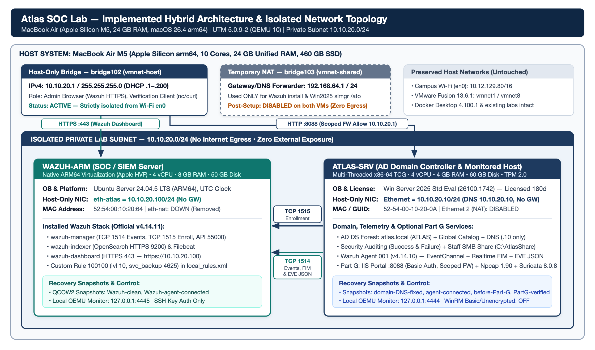
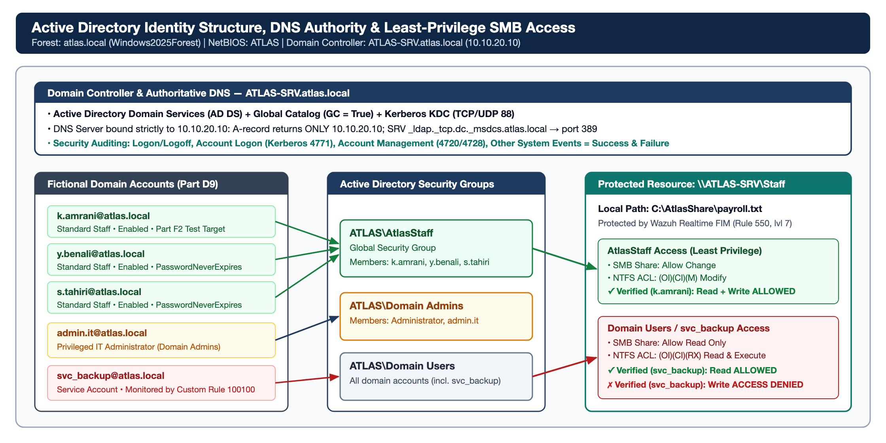
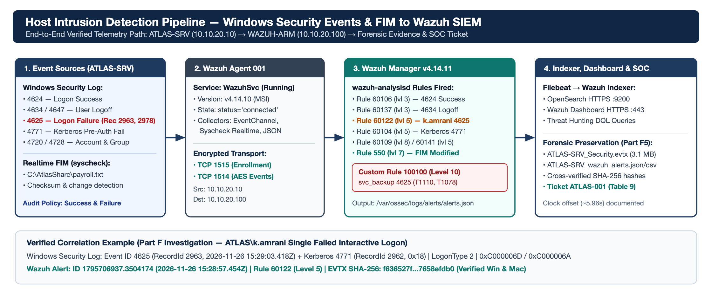
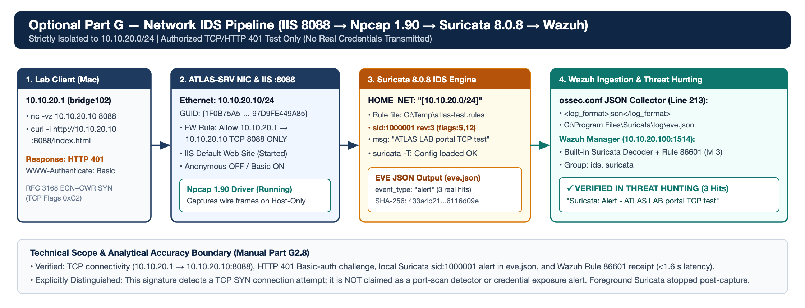
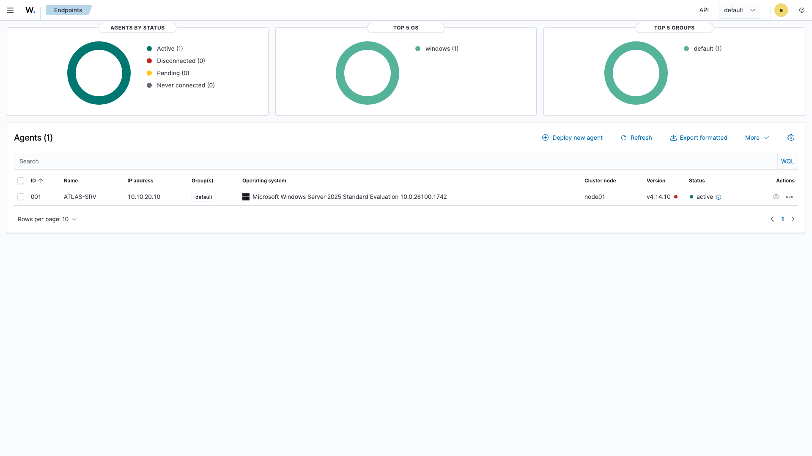
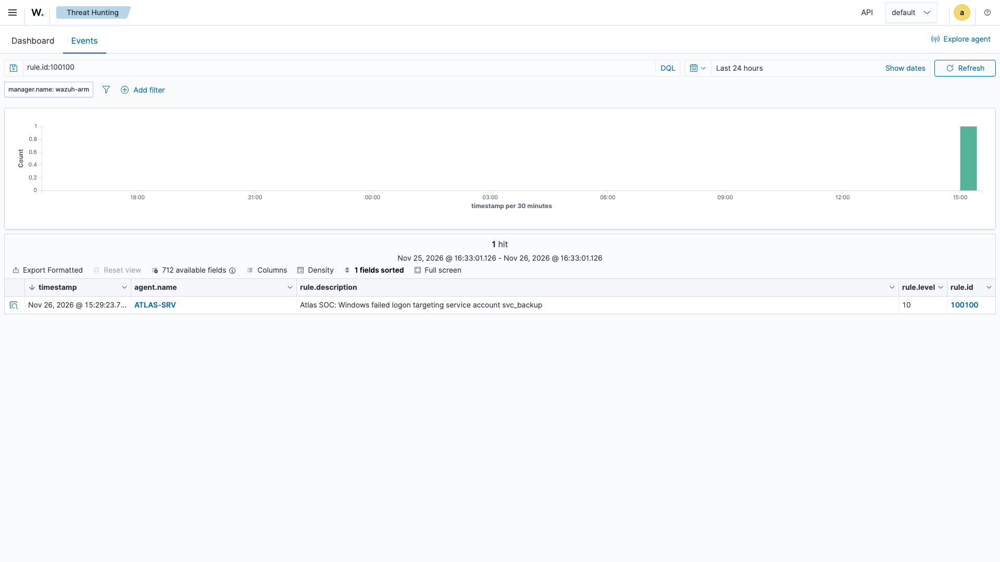
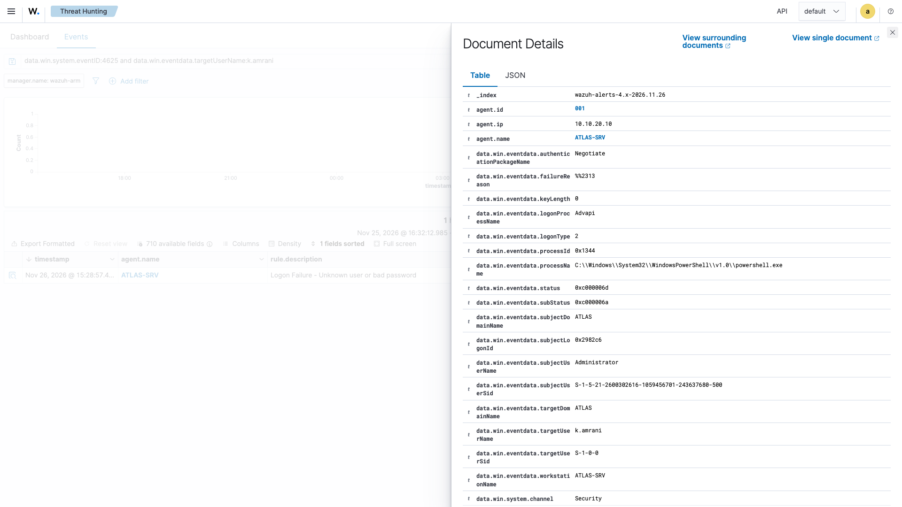
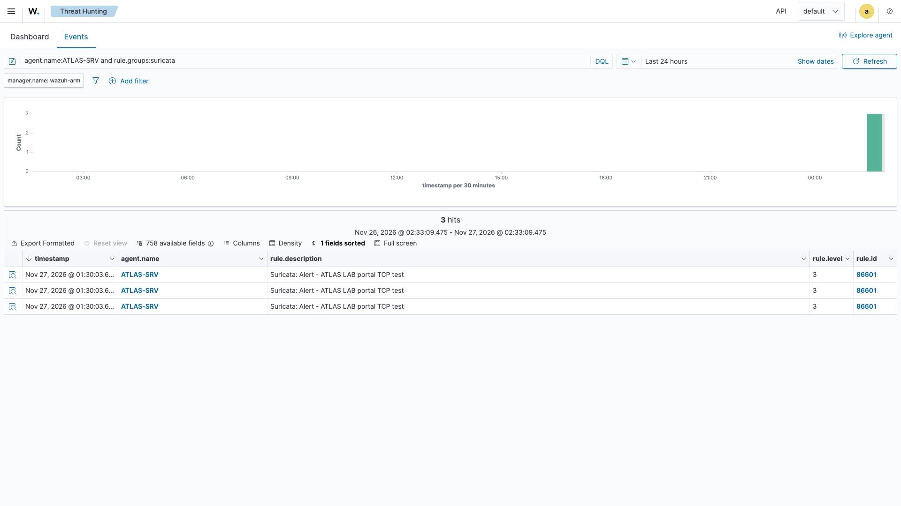

# Atlas SOC Detection Lab

A reproducible, isolated Security Operations Centre (SOC) laboratory built on **Apple Silicon (MacBook Air M5, macOS 26.4 `arm64`)** using **UTM 5.0.9-2 (QEMU 10)**, integrating a genuine **Windows Server 2025 Active Directory Domain Controller (`atlas.local`)**, **Wazuh SIEM v4.14.11**, Windows Security Auditing, realtime File Integrity Monitoring (FIM), custom Wazuh detection rules, optional **Suricata 8.0.8** network intrusion detection, and SHA-256 verified forensic evidence collection.

> **Academic Context:** Developed for the Semester 9 *Intrusion Detection Tests* practical module (*Atlas SOC Lab*, Université Euromed de Fès — UEMF). This repository is maintained **private** and contains only sanitized configurations, reproducible automation, detection rules, architecture diagrams, and selected evidence — excluding credentials, private keys, raw EVTX dumps, VM disks, OS images, and third-party course PDFs.

---

## Architecture Overview

To achieve 100% functional parity with an x86-64 enterprise Windows Server 2025 SOC lab on Apple Silicon (`arm64`), this build uses a **hybrid virtualization architecture** inside an isolated `10.10.20.0/24` Host-Only network (`bridge102`, zero internet egress after setup):



| Node | OS & Build | Acceleration | Allocation | Isolated IP (`10.10.20.0/24`) | Implemented Roles |
|---|---|---|---|---|---|
| **Mac Host** | macOS 26.4 (`arm64`) | Physical Apple M5 (10c, 24 GB) | — | `10.10.20.1` (`bridge102`) | Wazuh Dashboard browser, verification client (`nc`/`curl`) |
| **`WAZUH-ARM`** | Ubuntu Server 24.04.5 LTS (`arm64`) | Native Apple HVF (`-accel hvf`) | 4 vCPU, 8 GB RAM, 50 GB | `10.10.20.100` (`eth-atlas`, no GW; `eth-nat` DOWN) | Official **Wazuh v4.14.11** (Manager, Indexer, Dashboard, Filebeat), Custom Rule `100100` |
| **`ATLAS-SRV`** | Windows Server 2025 Std Eval (`10.0.26100.1742`, Licensed 180d) | Multi-threaded QEMU TCG (`q35`, UEFI, TPM 2.0) | 4 vCPU, 4 GB RAM, 60 GB | `10.10.20.10` (`Ethernet`, no GW; `Ethernet 2` Disabled) | AD DS (`atlas.local`), DNS, Least-Privilege `Staff` SMB Share, Auditing, Wazuh Agent `001` (`v4.14.10`), Part G IIS `:8088` + Npcap `1.90` + Suricata `8.0.8` |

---

## Identity, Least-Privilege Access & Detection Pipelines

### Active Directory & Least-Privilege File Share (`atlas.local`)
- **DNS Fix for Multihomed DC:** DNS listeners restricted strictly to `10.10.20.10`; `nslookup -type=A ATLAS-SRV.atlas.local 10.10.20.10` returns **only `10.10.20.10`** alongside valid SRV `_ldap._tcp.dc._msdcs.atlas.local` (port `389`).
- **Least-Privilege Verification (`\\ATLAS-SRV\Staff` → `C:\AtlasShare\payroll.txt`):** `AtlasStaff` (`k.amrani`, `y.benali`, `s.tahiri`) has SMB `Change` + NTFS `Modify` (**Read + Write ALLOWED**); `Domain Users` (including `svc_backup`) has SMB `Read` + NTFS `Read & Execute` (**Read ALLOWED, Write ACCESS DENIED**).



### Host Telemetry & Detection Pipeline (HIDS + FIM + Custom Rule `100100`)



### Optional Network IDS Pipeline (Part G — IIS `:8088` → Npcap `1.90` → Suricata `8.0.8` → Wazuh)



---

## Verified Detection Results

All detections below were executed against the live virtual machines using controlled, non-destructive authorized tests:

| Test Case | Trigger Activity | Native Event / Sensor | Wazuh Rule & Level | Verified Result |
|---|---|---|---|---|
| **Baseline Telemetry (Part E6)** | Normal interactive logon & logoff | Windows `4624` & `4634` | `60106` (lvl 3) & `60137` (lvl 3) | PASS — Live baseline verified |
| **Failed Logon Investigation (Part F)** | Single failed interactive logon (`ATLAS\k.amrani`, `LogonType 2`) | Windows `4625` (`RecordId 2963`, `0xC000006D`/`0xC000006A`) & Kerberos `4771` (`2962`, `0x18`) | `60122` (lvl 5) & `60104` (lvl 5) | PASS — Correlated in [SOC Ticket ATLAS-001](investigations/SOC-Investigation-Ticket-ATLAS-001.md) (triaged as benign; not brute force) |
| **Account Lifecycle (App. E P2 T2)** | Create temp user `t.detect` & add to `AtlasStaff` (cleaned up) | Windows `4720` (`2964`) & `4728` (`2970`) | `60109` (lvl 8) & `60141` (lvl 5) | PASS — Live detection verified |
| **Realtime FIM (App. E P2 T3)** | Modify & restore `C:\AtlasShare\payroll.txt` | Wazuh `syscheck` realtime | `550` (lvl 7, 3 hits) | PASS — Real-time checksum change alerted |
| **Offline Decoder Test (App. E P2 T5)** | `wazuh-logtest` OpenSSH test records | `sshd` decoder | `5716` (lvl 5) & `5760` (lvl 5) | PASS — [tests/wazuh-logtest-t5-5716.txt](tests/wazuh-logtest-t5-5716.txt) |
| **Custom Rule `100100` (App. E P3)** | Single failed logon targeting `ATLAS\svc_backup` | Windows `4625` (`RecordId 2978`) | **Custom `100100` (lvl 10)** ([detections/wazuh-local_rules.xml](detections/wazuh-local_rules.xml)) | PASS — Level-10 service-account alert fired live |
| **Network IDS → SIEM (Part G2)** | Authorized `nc`/`curl` to `10.10.20.10:8088` (HTTP 401 Basic Auth) | Suricata `8.0.8` `eve.json` ([detections/suricata-atlas-test.rules](detections/suricata-atlas-test.rules), `sid:1000001`, `flags:S,12`) | **`86601` (lvl 3, `suricata`)** — 3 hits | PASS — End-to-end packet → EVE JSON → Wazuh Threat Hunting verified (<1.6 s) |

### Selected Visual Evidence

| Active Wazuh Agent (`001 ATLAS-SRV`) | Custom Rule `100100` (Level 10, `svc_backup`) |
|---|---|
|  |  |

| Expanded Windows Event `4625` in Wazuh | Suricata `8.0.8` Alert in Wazuh Threat Hunting (`86601`) |
|---|---|
|  |  |

---

## Forensic Evidence Integrity & Key Troubleshooting Lessons

- **Cross-Platform SHA-256 Verification:** All preserved local evidence artifacts are tracked in [evidence/SHA256SUMS.txt](evidence/SHA256SUMS.txt) (31 verified files). Both `ATLAS-SRV_Security.evtx` (`f636527fa29353c8b3d62e22871ca51da17861b3b538dbbc618b04a7658efdb0`) and Suricata `eve.json` (`433a4b21e4816ce76ae1cf0b6c686383e6d3db4d6a6893d251cbf07f6116d09e`) matched bit-for-bit between Windows `Get-FileHash` and macOS `shasum -a 256`.
- **Notable Real-World Engineering Findings** (full 15-issue log in [docs/troubleshooting.md](docs/troubleshooting.md)):
  - **macOS RFC 3168 ECN+CWR TCP SYN Flags (`0xC2`):** Live `eve.json` flow inspection revealed macOS enables ECN+CWR on outgoing SYNs, causing bare Suricata `flags:S;` to miss them; switching `sid:1000001` to official Suricata mask syntax `flags:S,12;` immediately resolved detection while preserving strict SYN-only matching.
  - **QEMU TCG Clock Offset (+5.96 s):** Correlated Windows Security events and Wazuh alerts unambiguously via immutable `EventRecordID` rather than wall-clock timestamp equality alone.
  - **Apple HVF ARM64 UEFI Warm-Reset Quirk:** Prefer clean shutdown (`sudo shutdown -h now`) + Start in UTM rather than in-guest `sudo reboot` on `WAZUH-ARM`.

---

## Repository Structure

```text
atlas-soc-detection-lab/
├── README.md
├── .gitignore
├── architecture/         # Vector SVG/PNG architecture diagrams & network plan
├── infrastructure/       # UTM VM specifications & software version manifest
├── automation/           # Reproducible PowerShell, Python & Bash lab scripts
├── configurations/       # Exported Windows, Wazuh & Suricata configs
├── detections/           # Custom Wazuh Rule 100100 & Suricata sid:1000001
├── tests/                # Sanitized validation & post-reboot test outputs
├── evidence/             # SHA-256 manifest, screenshot inventory & sample JSON alert
├── screenshots/          # Selected verified original screenshots (no secrets)
├── investigations/       # Table 9 SOC Investigation Ticket ATLAS-001
└── docs/                 # Compatibility, troubleshooting, RTM, validation & operating guides
```

## Scope & Limitations
- This is an isolated academic teaching laboratory (`10.10.20.0/24`), not a production enterprise SOC.
- Instructor-only exercises (Part G2.8 Nmap/Basic-Auth credential transmission and Part H Atomic Red Team) were intentionally excluded.
- Temporary NAT interfaces and WinRM provisioning settings were disabled after setup and verified disabled post-reboot.
