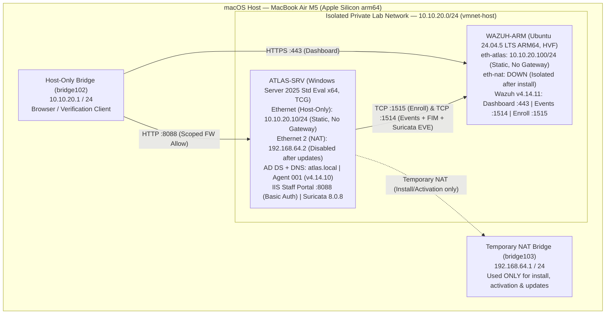

# Atlas SOC Lab — Implemented Network & Virtualization Architecture

## Architecture Decision Summary

- **Host Machine:** MacBook Air (Apple Silicon **M5**, 10 cores, 24 GB RAM, 460 GB SSD, macOS 26.4 `arm64`)
- **Selected Architecture:** **Option A — Full Professor-Equivalent Implementation (Hybrid Native ARM64 + Emulated x86-64 via UTM 5.0.9-2 / QEMU 10)**
  - **`WAZUH-ARM` (`10.10.20.100`)**: Native ARM64 Ubuntu 24.04.5 LTS running on Apple Hypervisor.framework (`-accel hvf`), 4 vCPUs, 8 GB RAM, 50 GB qcow2 disk, running official **Wazuh v4.14.11** (Manager + Indexer + Dashboard + Filebeat).
  - **`ATLAS-SRV` (`10.10.20.10`)**: Genuine **Windows Server 2025 Standard Evaluation (Desktop Experience, Build 26100.1742 x86-64)** running under multi-threaded QEMU TCG (`-accel tcg,thread=multi`, `q35`, UEFI + `swtpm` TPM 2.0, VirtIO storage & network drivers), 4 vCPUs, 4 GB RAM, 60 GB qcow2 disk. Active Directory Domain Services (`atlas.local`), DNS, Staff SMB Share, Security Auditing, Wazuh Windows Agent v4.14.10, IIS Portal (port 8088), and Suricata 8.0.8.

## Network Topology Diagram

## Address Plan & Deviation Record

| Component | Manual Plan (VirtualBox) | Implemented Value (UTM/QEMU on M5) | Status / Deviation Note |
|---|---|---|---|
| Private Subnet | `10.10.20.0/24` | `10.10.20.0/24` (`vmnet-host`, `bridge102`) | Exact match |
| Host Adapter | `10.10.20.1/24` | `10.10.20.1/24` (`bridge102`) | Exact match |
| DHCP Allocation | `10.10.20.2` (`.100–.200`) | macOS `vmnet` built-in DHCP (`.1–.200`); VMs pinned to `.10` and `.100` | Platform equivalent (`vmnet-host` DHCP) |
| `ATLAS-SRV` Host-Only | `10.10.20.10/24` (No GW) | `10.10.20.10/24` (`Ethernet`, MAC `52:54:00:10:20:0a`, No GW) | Exact match |
| `ATLAS-SRV` Temp NAT | `10.0.3.15` (VirtualBox NAT) | `192.168.64.2` (`Ethernet 2`, MAC `52:54:00:10:20:f2`, `vmnet-shared`) | Standard macOS `vmnet-shared` subnet; disabled from DNS registration |
| `WAZUH-ARM` | `10.10.20.100/24` | `10.10.20.100/24` (`eth-atlas`, MAC `52:54:00:10:20:64`, No GW) | Exact match (`eth-nat` shut down post-install) |
| Domain / Forest | `atlas.local` (`ATLAS`) | `atlas.local` (`ATLAS`) | Exact match — genuine Windows Server 2025 AD DS |
| Existing Host Networks | Preserved untouched | VMware Fusion `vmnet1` (`172.16.139.0/24`), `vmnet8` (`172.16.174.0/24`), Campus Wi-Fi (`10.12.0.0/16`) untouched | Zero conflicts or traffic leakage |
